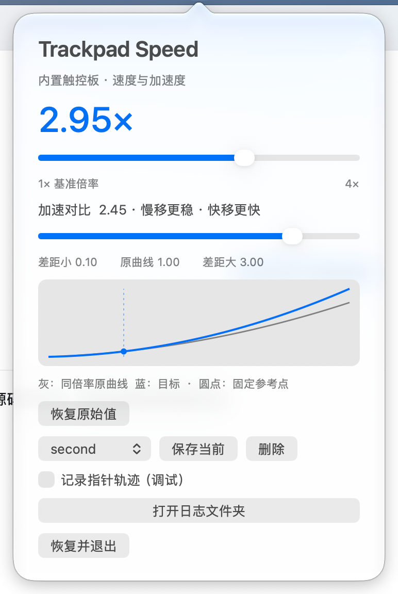

# Trackpad Speed

为 **系统最高跟踪速度仍然不够快** 的 MacBook 内置触控板，增加速度和加速度调节。

多屏、大屏工作时，跨屏移动常常要反复挪动手指；只把指针调快，又可能影响精细定位。
Trackpad Speed 把「整体速度」和「慢快差距」分开调整，让跨屏移动和精细操作都能找到舒服的手感。



## 主要功能

- **突破系统滑块的调节范围**：以原始曲线为基准，提供 **1–4×** 目标速度倍率。
- **慢移更稳，快移更快**：加速对比支持 **0.10–3.00**。围绕固定参考点调整慢快差距，不再把整条曲线一起压慢。
- **松开即生效**：两个滑块调整后自动应用，不需要额外点击按钮。
- **精确输入倍率**：双击蓝色倍率数字，输入如 **2.375** 的数值，最多支持三位小数。
- **设置组一选即用**：保存、切换和删除命名设置组，快速找回常用手感；同名保存会更新原组。
- **曲线变化看得见**：灰线是同倍率原曲线，蓝线是目标曲线，圆点标出保持不变的参考点。
- **一键恢复原始值**：同时撤销速度和曲线调整，也可选择「恢复并退出」。
- **原生菜单栏工具**：随用随调；调节针对内置触控板，不主动修改外接鼠标和滚动设置。

## 快速上手

1. 打开 `Trackpad Speed.app`，点击菜单栏的指针图标。
2. 先调 **整体速度**，找到合适的跨屏移动速度；再调 **加速对比**，比较慢移定位和快移跨屏。
3. 想精确输入时，双击倍率数字；想留住当前手感时，点击 **保存当前** 并命名。
4. 以后从设置组列表选择即可应用。删除设置组只移除保存记录，不改变当前参数。

升级时先退出旧版。启动应用本身不会自动启用调速，主动调节滑块或选择设置组才会应用。

## 两个滑块怎么配合

| 控件 | 作用 |
| --- | --- |
| 整体速度 | 统一调快或调慢，范围 1–4× |
| 加速对比 = 1 | 保持原始曲线形状 |
| 加速对比 > 1 | 相对同倍率原曲线，参考点以下更慢、以上更快 |
| 加速对比 < 1 | 缩小慢快差距，参考点以下更快、以上更慢 |

**固定整体倍率时，调整对比会保持参考点的目标速度不变。** 参考点是曲线模型中的数学位置，预览不是实测手指轨迹。

## 恢复与日志

点击 **恢复原始值** 可撤销两项调节。正常退出会尝试恢复；睡眠时也尝试恢复，唤醒后不自动重新启用。

操作日志自动记录写入、实际过滤器系数核对和恢复结果。指针轨迹监控是可选调试功能，日常使用可以关闭。
日志每份最多 **2 MiB**，最多保留 **3 份**，总量约 **6 MiB**；不会无限增长。

## 运行与构建

提供 Apple Silicon 原生应用；最低部署版本为 macOS 14，目前在 **macOS 27.0.1** 上做过实机核对。
应用使用内部 HID 接口，系统升级后可能需要适配，不保证所有机型和系统版本均可用。
曲线参数和实际过滤器状态可核对，精确物理倍率仍需要独立测量。

有 Apple Command Line Tools 时，可在源码目录执行：

```sh
./build.sh
```

生成的应用位于源码目录的上一级。数学、恢复、设置组和控件测试可分别执行：

```sh
./test.sh
./test-ui.sh
./test-storage.sh
```

详细原理、兼容性、恢复机制与验证边界见 [技术与验证说明](TrackpadSpeed/docs/TECHNICAL_NOTES.txt)。
